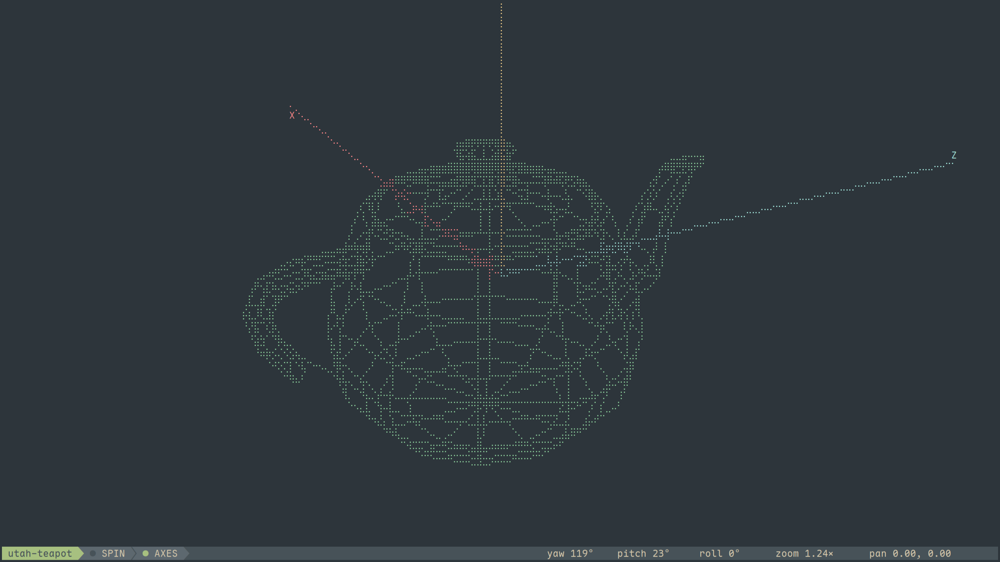

# Wireforge

[](https://crates.io/crates/wireforge)

Wireforge is a TUI viewer for 3D wireframe models. Point it at a `.wrfm` file
and turn the model around with the keyboard. The repository also holds the
`.wrfm` file format, a Rust library that reads and writes it, and a `wrfm`
command line tool that validates, inspects, transforms, edits and renders
models over plain stdio.



## Overview

`.wrfm` is a 3D model format containing a set of points and the lines between
them. The file opens with a magic line (`wrfm 2`) and a counts header, then
`v <x> <y> <z>` lines for the points and `e <a> <b>` lines for the edges. `#`
starts a comment; named groups are optional. A tetrahedron fits in twenty
lines.

Because it is plain text, the ordinary tools work on it: your editor edits it,
`diff` shows what changed, and a whole model fits in a code review.

The repository holds the viewer and the pieces around it:

- **`wireforge`** — the viewer, and the main program here. Open a file and
  turn it around with the keyboard; run it with no file and the empty space
  still comes up, XYZ axes and all.
- **`.wrfm`** — the format the viewer reads. The current version is v2.
- **[`wrfm`](crates/wrfm)** — a zero-dependency Rust library that parses and
  serializes that format, with `no_std` support and exact `f64` round-trips.
  The viewer and the CLI read models through it.
- **[`wrfm` CLI](crates/wrfm-cli)** — the command line tool, installed as
  `wrfm` from the `wrfm-cli` package. It has fourteen subcommands that
  check, verify, inspect, query, view, render, transform, edit, convert,
  reformat and diff models over plain stdio. The viewer does not need it.
- **[`wrfm-raster`](crates/wrfm-raster)** — the shared renderer: camera
  projection and braille rasterization used by the viewer and the CLI,
  byte-identical to ratatui's canvas.

## Features

- **Content, not extensions.** The viewer looks at the file contents, not the
  name: a model in a `.txt` opens as a model, OBJ content is rejected with a
  hint to run `wrfm convert`, and a broken model fails with the parser's
  line-and-column report on stderr.
- **Keyboard control.** Rotate, pan and zoom with `hjkl`, the arrow keys,
  `d`/`f` and `+`/`-`; `Ctrl+hjkl`, `Ctrl+arrows` and `Ctrl+d`/`Ctrl+f` turn the
  model around its own axes instead of the world's. `r` resets the view and
  `Space` spins the model. `Esc` opens a menu with Key Bindings, About and Exit;
  Key Bindings is the only way into the key reference — the bar carries no key
  hints. One bar under the model names the file in an accent pill, carries the
  state lamps and reports the camera in degrees, zoom multiples and model
  units. The reference is generated from the key table and checked against it,
  so a rebind cannot leave it behind. The bar is laid out like a powerline
  statusline — its blocks are joined by the wedges lualine draws (U+E0B0 and
  U+E0B1) — while the panels stay on stock glyphs.
- **Everything is a pipe.** The viewer reads stdin (`wireforge -`) and the CLI
  writes nothing to disk, so commands chain with pipes:

  ```bash
  wrfm convert mouse.obj | wireforge -
  wrfm edit model.wrfm --extract-group cabinet | wrfm transform - --scale 2 | wireforge -
  ```

- **CPU rendering.** Rendering runs on the CPU only, drawing braille cells, with
  no GPU, no GUI toolkit, and no display server. The event loop sleeps when
  nothing changes and redraws at full speed while you animate. Projection and
  rasterization switch to parallel (rayon) paths on large models.
- **Built for scripts.** The CLI writes its result to stdout and its
  diagnostics to stderr, and its exit code says how things are: ok, warn,
  broken, or no result at all. A CI job can assert on a model the same way it
  asserts on a test suite.

## The Esc menu

Press `Esc` for the hub: Key Bindings, About and Exit. `j`/`k` or the arrow
keys move, `Enter` selects, and `Esc` closes. Panels opened from the menu return
there on `Esc`; `q` and `Ctrl+C` quit from anywhere.

## Getting started

```bash
cargo install wireforge    # the viewer
cargo install wrfm-cli     # optional: the `wrfm` command line tool
```

It is also on the [AUR](https://aur.archlinux.org/packages/wireforge), and can
be built from source with `cargo build --release`. [SPEC.md](SPEC.md) walks
through installation, the viewer, its key bindings, and the format itself.

## Documentation

[SPEC.md](SPEC.md) — installation, viewer usage, the full key table, and the
`.wrfm` format.

[crates/wrfm-cli/README.md](crates/wrfm-cli/README.md) — the complete CLI
reference, covering every subcommand, recipe, and exit-code contract.

[crates/wrfm/README.md](crates/wrfm/README.md) — using the parser library.

[crates/wrfm/docs/wrfm-spec.md](crates/wrfm/docs/wrfm-spec.md) — the
authoritative v2 specification (EBNF grammar, error variants, canonical form,
BOM and whitespace rules, parser behaviour).

[crates/wrfm-raster/README.md](crates/wrfm-raster/README.md) — the shared
camera projection and braille rasterization API.

Release history: [wireforge](CHANGELOG.md), [wrfm](crates/wrfm/CHANGELOG.md),
[wrfm-cli](crates/wrfm-cli/CHANGELOG.md),
[wrfm-raster](crates/wrfm-raster/CHANGELOG.md) — one changelog per crate, each
on its own release axis.

## License

[MIT](LICENSE)
